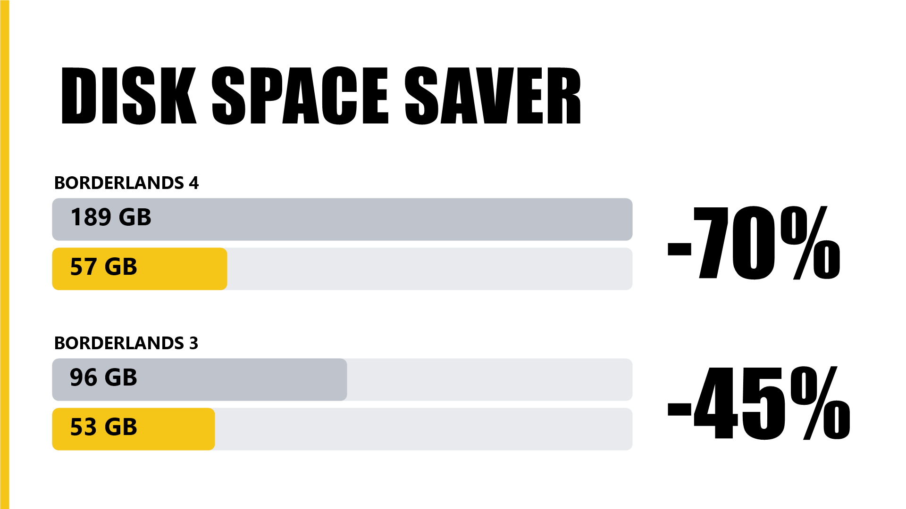

# bl4-slim

Shrinks a Borderlands 4 install on Windows.

## What it removes

1. **Voice languages you don't use.** Steam installs the voices for all 8 languages, each is ~9gb. Keep the ones you use. English is always kept\*, we think the game needs it.
2. **Old patch data.** Every update adds new pak files and the old ones take up space. The game only reads the newest copy. The old copies share files with data the game still needs. 
The script blanks only the dead byte ranges (NTFS sparse files).

It reads the game's own file indexes to work out what to do, so it keeps working after updates.

## How to use

1. Close the game and let Steam finish any update.
2. Download the zip, unzip it anywhere, and double-click `bl4-slim.cmd`.
3. Pick the voice languages to keep. Use the ones your game's voice settings are on. Type more than one number to keep several, like `1,3`. Enter keeps English.
4. It shows what it will remove. Type `y` to go ahead.

Run it again after every game update, updates unfortunately bring the old copies back.

It finds the game through Steam on its own. If it can't (Epic, or an unusual setup), it asks you to paste the game folder.

### Options

From a command prompt in the unzipped folder:

| Command | What it does |
|---|---|
| `bl4-slim.cmd -Scan` | shows what it would remove. Your game files stay as they are, but it makes and deletes one 8 MB test file in the Paks folder |
| `bl4-slim.cmd -Keep German` | keeps German without asking (English is kept too\*) |
| `bl4-slim.cmd -Keep "German,English(US)"` | keeps both |
| `bl4-slim.cmd -GameDir "D:\Games\Borderlands 4"` | uses that game folder |
| `bl4-slim.cmd -Yes` | skips the "Go ahead?" question |

## Undo

In Steam, open Properties, then run "Verify integrity of game files". Steam grabs all the files again.

## \*Why English is always kept

One user kept only the Korean voices and deleted English. The first mission then showed a "required content" pop-up. With English back it worked. We think the game needs the English voice files, but this needs more digging.

Thanks to SolTeLu on Nexus Mods for finding it.

## Tested

Steam version, Windows 10/11.
Not tested yet: Epic version

Use at your own risk. Back up OakGame\Content\Paks first if you are nervous.

## License

MIT
